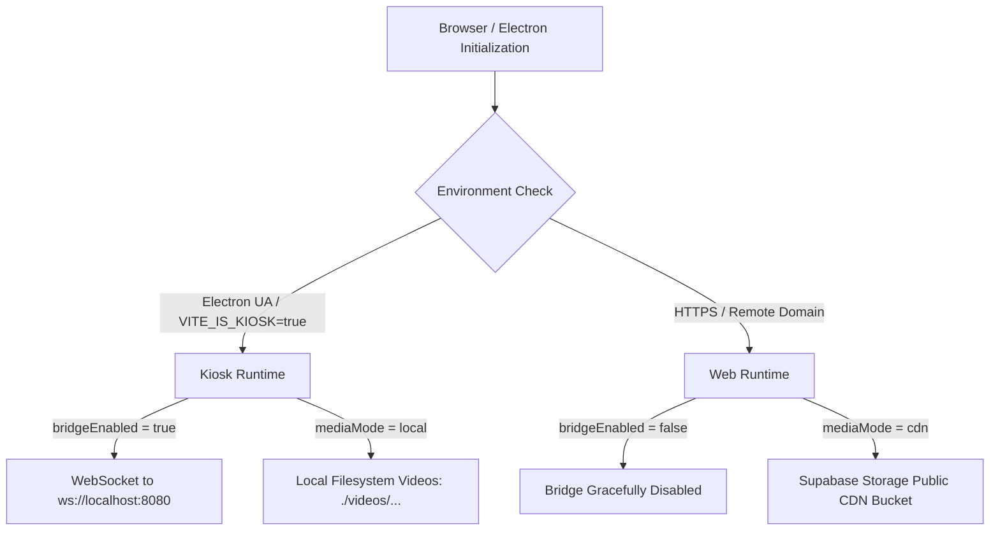
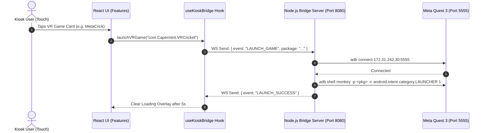

# 🏛️ Campus Verse — System Architecture

This document describes the codebase architecture, layer separation, data flow, and runtime environment handling for **Campus Verse**.

---

## 1. Directory Structure

```text
src/
├── app/                        # Application entry, global wrappers & error boundaries
│   ├── App.jsx                 # Lazy-loaded router with Suspense
│   └── ErrorBoundary.jsx       # Kiosk-resilient crash screen with 10s auto-reset
│
├── features/                   # Self-contained domain features (<250 lines/file)
│   ├── landing/                # 3D landing page & canvas setup
│   │   ├── components/         # 3D Scene, BurstParticles, Shockwave, Headset
│   │   └── LandingPage.jsx     # Gesture-scrubbing hero orchestrator
│   │
│   ├── hub/                    # Destination Hub (3 portals) & interactive drawers
│   │   ├── components/         # HubCard, DestinationHub, AboutDrawer, ExploreDrawer
│   │   └── UIOverlay.jsx       # 2D HUD overlay coordinating views & controls
│   │
│   ├── dashboard/              # Academic & innovation collection showcase
│   │   ├── components/         # BentoCard, DepartmentCard, MediaThumb, MediaStageModal
│   │   └── DashboardPage.jsx   # Bento grid collections & cinema player
│   │
│   ├── faculty/                # Leadership & faculty innovators directory
│   │   ├── components/         # FacultyCard
│   │   └── FacultyPage.jsx     # Responsive faculty directory
│   │
│   ├── about/                  # Spatial computing manifesto & 3D kiosk cad
│   │   ├── components/         # KioskModel (CAD), panelArt (dynamic canvas textures)
│   │   └── AboutPage.jsx       # Dedicated vision page
│   │
│   └── vr-games/               # VR arcade grid & hardware launcher
│       └── components/         # VrGamesGrid, VRLaunchOverlay
│
├── shared/                     # Reusable cross-feature utilities and tokens
│   ├── components/             # BrandMarks, AmbientField, LoadingScreen
│   ├── hooks/                  # Reusable UI & interaction hooks
│   ├── config/                 # Typed runtime environment configuration
│   │   └── env.js              # Single source of truth for kiosk vs web
│   └── styles/                 # Global styles, fonts, and Tailwind definitions
│
├── services/                   # External API, hardware bridge & cloud connectors
│   ├── bridge/                 # Local WebSocket bridge & ADB command dispatching
│   ├── supabase/               # Supabase database & storage client
│   └── media/                  # Media URL resolution (local filesystem vs CDN)
│
└── data/                       # Content definitions (pre-Supabase seed & offline backup)
    ├── cards.js                # Dashboard collection cards
    ├── departments.js          # Engineering departments
    ├── departmentVideos.js     # Media playlists & direct videos
    ├── vrGames.js              # VR standalone game package IDs
    ├── faculty.js              # Faculty bios & photos
    ├── credits.js              # Student creator minds
    └── hub.js                  # Destination hub items
```

---

## 2. Runtime Environment Detection (`shared/config/env.js`)

Campus Verse runs in two distinct environments from the same codebase:
1. **Physical Kiosk (Electron)**: 1080×1920 portrait fullscreen, touch-only, offline-first with local video fallback and local WebSocket bridge (`ws://localhost:8080`).
2. **Cloud Web App (Vercel)**: Responsive desktop/mobile, media served via Supabase Storage CDN, hardware bridge disabled on HTTPS to prevent browser mixed-content security blocks.



---

## 3. Component Interaction & Data Flow



---

## 4. Resilience & Error Recovery

- **Global Error Boundary**: `src/app/ErrorBoundary.jsx` catches unexpected WebGL or React crashes and displays a high-tech kiosk warning with an automatic 10-second countdown reset to return to the home screen.
- **Route-Level Code Splitting**: All major pages and the heavy 3D WebGL scene are wrapped in `React.lazy` and `Suspense` with a branded `LoadingScreen`, reducing the main initial bundle from **90 kB down to 6.5 kB**.
